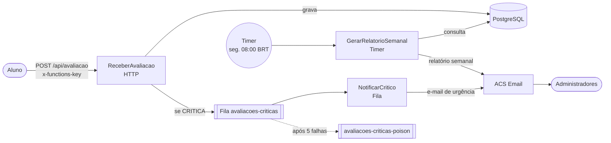

# Plataforma de Feedback

Tech Challenge da Fase 4 (Cloud Computing, Serverless e Deploy). Os estudantes avaliam as aulas, os administradores recebem um aviso imediato das avaliações críticas e, toda semana, um relatório com a média das notas.

A aplicação é serverless (Azure Functions) e roda na Microsoft Azure.

> A documentação técnica completa está no PDF entregue com o trabalho: arquitetura, modelo de cloud, segurança, deploy passo a passo, monitoramento e decisões de projeto.

## Arquitetura



Transversal: Key Vault com Managed Identity (segredos), Application Insights (telemetria) e alertas do Azure Monitor com Action Group (e-mail aos administradores).

## Funções

| Função | Gatilho | Responsabilidade |
|---|---|---|
| `ReceberAvaliacao` | HTTP `POST /api/avaliacao` (chave de função) | Valida, classifica a urgência e grava a avaliação. Se for crítica, publica na fila |
| `NotificarCritico` | Fila `avaliacoes-criticas` | Envia o e-mail de urgência (descrição, urgência, data de envio). Não acessa o banco |
| `GerarRelatorioSemanal` | Timer (`RELATORIO_CRON`, em UTC) | Envia o relatório com total, média, quantidade por dia e por urgência, e a lista de avaliações |

### Endpoint

```http
POST /api/avaliacao
x-functions-key: <chave>
Content-Type: application/json

{ "descricao": "Aula confusa", "nota": 2 }
```

| Código | Situação |
|---|---|
| 201 | Avaliação gravada: `{"id", "urgencia", "dataEnvio"}` |
| 400 | JSON inválido, tipo errado (ex.: `"5"`, `5.5`), nota fora de 0–10, descrição vazia ou com mais de 1000 caracteres |
| 401 | Chave de função ausente ou inválida |
| 500 | Falha inesperada |

### Regra de urgência

| Nota | Urgência | Efeito |
|---|---|---|
| 0 a 3 | `CRITICA` | Grava e notifica os administradores |
| 4 a 6 | `MEDIA` | Grava |
| 7 a 10 | `BAIXA` | Grava |

O relatório semanal cobre os 7 dias de calendário que terminam no dia da execução (fuso de Brasília). As datas são gravadas em UTC e exibidas no horário de Brasília.

## Stack

Java 21 · Quarkus 3 (`quarkus-azure-functions`) · Hibernate ORM com Panache · Hibernate Validator · PostgreSQL 16 · Azure Storage Queue · Azure Communication Services Email · Key Vault · Application Insights · GitHub Actions

## Estrutura

```
src/main/java/org/fiap/com/
  function/     funções (adaptadores dos gatilhos) e checagem de tipos do JSON
  service/      regras de negócio, cálculo do relatório e montagem dos e-mails
  repository/   acesso ao banco (Panache)
  model/        entidade, enum de urgência, DTOs e contrato da mensagem da fila
db/             schema.sql (tabela) e roles.sql (usuário da aplicação com privilégio mínimo)
docs/           monitoramento.kql (consultas do Application Insights e do alerta)
.github/workflows/
  ci.yml        PR para main: build, testes e varredura de segredos (Gitleaks)
  deploy.yml    push na main: build, testes, login OIDC, deploy e teste de fumaça
```

## Executar os testes

Pré-requisitos: JDK 21 e Docker. Os testes com banco usam o Dev Services do Quarkus, que sobe um PostgreSQL em container.

```bash
./mvnw clean verify
```

Banco local opcional (aplica `db/schema.sql`):

```bash
echo "POSTGRES_PASSWORD=<senha-local>" > .env   # não versionar
docker compose up -d
```

## Deploy

O deploy é automático a cada push na `main` (`.github/workflows/deploy.yml`). O login na Azure é feito por OIDC, sem senha armazenada no GitHub. O pipeline espera estes segredos do repositório: `AZURE_CLIENT_ID`, `AZURE_TENANT_ID` e `AZURE_SUBSCRIPTION_ID`.

App Settings que a Function App precisa ter:

| Nome | Conteúdo |
|---|---|
| `DB_URL` | `jdbc:postgresql://<servidor>:5432/feedback?sslmode=require` |
| `DB_USER` | `feedback_app` |
| `DB_PASSWORD` | referência ao Key Vault |
| `ADMIN_EMAILS` | e-mails separados por vírgula |
| `EMAIL_SENDER` | `DoNotReply@<domínio>.azurecomm.net` |
| `ACS_CONNECTION_STRING` | referência ao Key Vault |
| `RELATORIO_CRON` | `0 0 11 * * MON` (segunda 08:00 BRT). Precisa existir antes do deploy |

O provisionamento da infraestrutura, o primeiro deploy e a configuração do monitoramento estão descritos no PDF.

### Disparo manual do relatório (demonstração)

```bash
curl -X POST "https://<app>.azurewebsites.net/admin/functions/GerarRelatorioSemanal" \
  -H "x-functions-key: <chave-mestra>" -H "Content-Type: application/json" -d '{}'
```

A chave mestra dá acesso administrativo ao app: nunca a versione nem a exiba em gravações.

## Segurança (resumo)

- Segredos ficam apenas no Key Vault e são lidos pela Managed Identity da Function App.
- O banco é acessado por um usuário com privilégio mínimo (`SELECT`/`INSERT` em `avaliacao`), com TLS obrigatório.
- A API exige chave de função e só aceita HTTPS. O texto do aluno é escapado nos e-mails e nunca vai para os logs.
- O deploy usa OIDC e o CI roda o Gitleaks em todo Pull Request.
